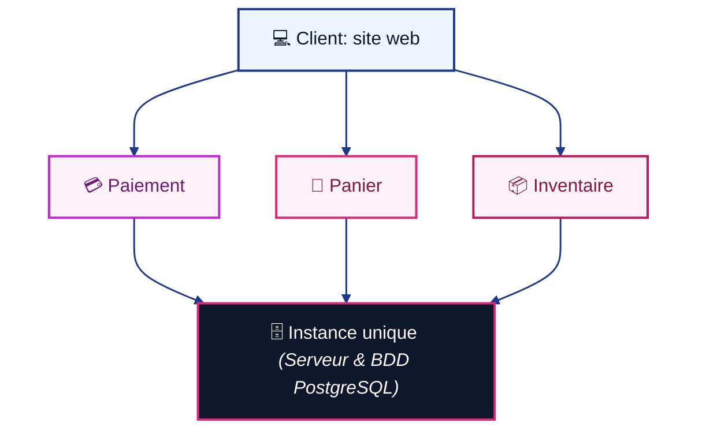

# Architecture Data Cloud

_Lors du cours d'introduction au Big Data, vous avez conçu un pipeline ELT. Durant ces cinq jours, nous allons prendre du recul et concevoir l'architecture data sur le cloud en proposant une alternative moderne à une application monolithique existante. Pour cela, nous allons travailler sur un projet fil rouge : une compagnie de e-commerce._

---

 ***FastMarket est une entreprise de e-commerce en pleine croissance. Son système repose sur un monolithe classique hébergé sur un serveur unique, connecté à une base de données relationnelle PostgreSQL mutualisée pour l'ensemble des fonctionnalités.***

 ### Schéma de l'Architecture Monolithique Actuelle

### Le constat opérationnel (Retours des équipes métiers & décisionnelles)

L'entreprise fait face à des signaux d'alerte remontés quotidiennement par les différents services :

* **Tensions entre équipes métiers et direction technique :**  
  > *« À chaque fois que l'équipe marketing rafraîchit le tableau de bord des ventes le matin, l'équipe web nous appelle en panique car le site rame et des clients n'arrivent plus à valider leur panier d'achat. On nous a formellement interdit de générer des rapports entre 9h et 19h. »*  
  *(— Un Data Analyst)*

* **Rapports trop lents et historiques inexploitables :**  
  > *« Impossible d'obtenir une vision consolidée de l'année passée pour préparer les soldes : au-delà de trois mois d'historique, les requêtes plantent avec un message d'erreur d'expiration (timeout). Le pilotage se fait à vue avec des données partielles. »*  
  *(— La Direction Commerciale)*

* **Inquiétudes du service juridique (DPO) :**  
  > *« Des clients demandent la suppression définitive de leur compte et de leurs données personnelles. Pourtant, nous continuons de retrouver leurs informations dans d'anciens fichiers et certains rapports d'activité. Nous sommes dans l'incapacité de garantir notre conformité en cas de contrôle de la CNIL. »*  
  *(— Le DPO - Délégué à la Protection des Données)*

* **Incompréhension de la direction financière :**  
  > *« La facture d'infrastructure augmente tous les trimestres car la technique demande constamment d'augmenter la taille du serveur principal, sans que la rapidité de nos outils d'analyse ne s'améliore pour autant. Nous ne savons pas quel service consomme quoi. »*  
  *(— La Direction Financière)*

---

## Objectifs du Cours

L'objectif de ces 5 jours n'est pas d'écrire un simple script d'ingestion, mais d'endosser le rôle d'Architecte Data & Cloud.

En équipe, vous allez concevoir la migration technique complète de FastMarket vers une architecture moderne sur Google Cloud Platform (GCP) :

- Découpler le monolithe en isolant les contextes métiers vers des microservices autonomes 

- Concevoir un Data Lake robuste : Designer la topologie, les formats adaptés, le partitionnement et le cycle de vie.

- Modéliser pour l'analytique moderne : Sortir des schémas relationnels classiques (3NF) pour exploiter la puissance distribuée d'un entrepot de données comme BigQuery.

- Intégrer le RGPD dès la conception (Sécurité par le Design) : Mettre en œuvre le droit à l'effacement sur du stockage analytique immuable et sécuriser les accès aux données sensibles.

- Maîtriser les coûts (FinOps) : Anticiper et modéliser la facture cloud, en optimisant la consommation de ressources.

# Deroulement
JOUR 1 : Du Monolithe au Découplage
  Module 1 : Audit Technique du Monolithe

    Objectif : Diagnostiquer pourquoi le système traditionnel s'effondre lors d'une vente flash.
    Concepts abordés :
      - Conflit fondamental OLTP (Transactions) vs OLAP (Analytique / Rapports).
      - Analyse des goulots d'étranglement : verrous SQL (Table Locks) et limites du scaling vertical (Scale-up).
      - Enjeux réglementaires : l'échec du droit à l'oubli (RGPD) causé par le couplage fort en base de données.

    - Activité: Analyse d'un cas pratique basé sur des problèmes métiers
  

Module 2 : Découplage de la Base pour l'Analytique

    Objectif : Concevoir une architecture asynchrone pour soulager la base opérationnelle.
    Concepts abordés :
        Pourquoi et comment séparer le chemin transactionnel du chemin analytique.
        Introduction au comcept du CDC
        Modélisation de la solution cible 

   TP Pratique : Déploiement d'un pipeline CDC avec Datastream et 

JOUR 2 : L'Entrepôt Analytique & Gestion Multi-Sources
  Module 3 : Organisation de l'Entrepôt de Données (Data Warehouse)

    Objectif : Comprendre et structurer un stockage analytique taillé pour le volume.
    Concepts abordés :
      Pourquoi une base OLAP (BigQuery) est 100x plus rapide qu'un PostgreSQL pour agréger des millions de lignes.
      Organisation logique : Projets, Jeux de données (Datasets), Tables et partitionnement par date (pour éviter les scans complets coûteux).

   TP Pratique : Création du Dataset analytique sur BigQuery

  Module 4 : Ingestion Multi-Sources & Données Non Structurées

    Objectif : Centraliser des données hétérogènes nécessaires à l'analyse métier.
    Concepts abordés :
        La notion de stockage objet (Object Storage) pour le non structuré.
        Multi-source : croiser des données relationnelles (utilisateurs), des flux d'événements (achats) et des fichiers bruts (logs de navigation, photos de baskets).

    TP Pratique :

        Création d'un bucket Google Cloud Storage (GCS) pour stocker des exports JSON bruts.
        Création d'une table externe dans BigQuery qui requête directement les fichiers JSON posés sur Cloud Storage sans les charger.

 JOUR 3 : 

## Evaluation

Évaluation sera en deux parties:

1. **Evaluation continue**. Lors des activités et des exercices pratiques, vous serez sur la capacité à retransmettre ce que vous venez de faire (retour déxercice à l'oral) ainsi que l'investissement dans le travail d'équipe (prise de parole lors des questions du professeur, force de proposition lors du travail de groupe)

2. **Soutenance**. Lors du dernier jour, vous aurez a préparé une soutenance qui expliquer l'ensemble de la nouvelle architecture que vous proposeriez au management de l'entreprise fictive qui vous emploie. 
Il y aura deux aspects:
- _Explication non technique,_ dédiée aux décideurs. Celle ci sera orienté sur les coûts et les bénéfices que l'entreprise bénéficiera de cette nouvelle architecture.
- _Explications technique,_ dédié au leader technique de votre équipe informatique.